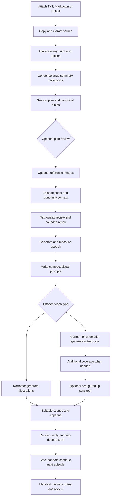

# Manuscript production: conversation analysis and implemented workflow

The [shared Novel Production Prompts conversation](https://chatgpt.com/share/6acc5262-74b4-83e8-83dd-4595d1370353) describes a production system built around one canonical story universe and three adaptations: narrated visual novel, animated cartoon and realistic cinematic series. Its most useful idea is a sequence of specialized production stages with shared bibles and continuity, rather than one enormous “make a video” prompt.

That workflow is now available in **Manuscript → videos**. Follow [TUTORIAL.md](TUTORIAL.md) for installation and step-by-step use. The [practice manuscript](examples/blue_gate_manuscript.txt) provides a small original input for a pilot.

## What the conversation implies

The 35 prompt areas cover source analysis, original development, canonical bibles, season planning, episode scripts, format-specific visual/audio work, manifests, quality control, continuity and delivery. They contain several distinct kinds of instruction:

| Instruction type | Appropriate implementation |
|---|---|
| Reasoning and writing | Text models with explicit, validated JSON contracts |
| Image/video/audio generation | Dedicated generation adapters or explicitly configured tools |
| Canon and continuity | Persistent entity IDs, reusable bibles, source references and episode handoffs |
| Asset management | Local files and a saved manifest, not a model's claim that a file exists |
| Assembly and delivery | FFmpeg rendering, stream inspection and full decoding |
| Creative approval | Human review of actual images, sound and video |

Prompts alone cannot supply a video model, animation rig, voice license, reference-conditioning mechanism or lip-sync engine. The UI therefore checks that selected profiles can perform required tasks and records the distinction between generated, technically validated and editorially approved work.

## Implemented flow

Each run produces one selected adaptation format. Running the same manuscript in another format currently creates a separate plan/story; sharing one approved canonical package across multiple format runs is a future extension. Within a run, characters, locations, bibles and all earlier episode handoffs are reused.

### Simple controls

The main page asks for the manuscript, title, format, adaptation approach, episode count, approximate length and task connections. Writing/review default to the selected planner. Advanced controls contain resolution, generation-stage limit, a plan-review pause, reference generation, installed voice name and per-character voice overrides. A paused plan can receive updated voice assignments before media generation begins.

The format choices change both script directions and production requirements:

- **Narrated visual novel:** narration-led scripts, generated illustrations and restrained still-image movement.
- **Animated cartoon:** dialogue/action-led scripts, stylized generated video and static playback of those clips in the editor.
- **Realistic cinematic:** cinematic dialogue/action scripts and actual generated video footage.

The guided outputs are vertical, at 360 × 640 or 1080 × 1920, with 30 FPS. Runtime is a target; recordings are measured and never silently shortened to meet it. Generated clip audio is muted so the separately finalized speech is not doubled.

## Built-in prompt coverage

The prompts are adapted into concise operational directions rather than stored as an unstructured transcript. The numbered library remains visible under **Built-in prompts**, and every actual request is saved beside its result. The original conversation link and prompt version are included in each run.

| Conversation prompts | Use in the implementation |
|---|---|
| 01 Showrunner | Common instructions: canon, stage boundaries, source as data |
| 02 Source analysis | Per-section summaries and hierarchical reduction |
| 03 Original concept | Explicit original-inspiration mode; faithful mode preserves the manuscript |
| 04 Season architecture | Season-plan contract |
| 05 Story bible | Persistent series bible |
| 06 Character bible | Stable character IDs, descriptions and optional reference images |
| 07 Location bible | Stable location IDs, layout descriptions and optional references |
| 08 Style/props/effects | Style bible and visual-prompt context; no separate prop-state database yet |
| 09 Audio bible | Voice/pronunciation directions; actual voice controlled by selected profiles |
| 10 Continuity audit | Script context and textual review |
| 11 Episode plan | Episode outlines and valid source-section references |
| 12 Beat sheet | Ordered, timed shot script |
| 13 Full script | Actual speech and visual directions |
| 14 Production breakdown | Shot-level cast, locations, timing and visuals |
| 15–18 / A1–A4 | Narrated adaptation, illustrations, motion, speech and edit guidance |
| 19–23 / B1–B5 | Cartoon scripts, references, environments, animation and sound directions |
| 24–28 / C1–C5 | Cinematic scripts, fictional cast, locations, footage and dialogue directions |
| 29 Asset manager | Saved stage records and production manifest |
| 30 Storyboard | Shot descriptions and compact visual prompts; no contact-sheet generator |
| 31 Captions | Exact script text, measured audio windows and proportional SRT |
| 32 Independent QC | Separate text-model route; one bounded script repair; local technical verification |
| 33 Continuity handoff | Proposed adaptation state recorded after each rendered episode |
| 34 Next episode | Existing bibles and all prior handoffs passed to the next script |
| 35 Delivery | Verified exports, local delivery notes and archive guidance; no automatic upload |

Long manuscripts are divided into sections of at most 12,000 characters. Every extracted character belongs to exactly one section. Summary reduction is explicit; it does not silently drop the book's ending. A script may reference one to six source sections, and validators reject nonexistent IDs. Very large bibles, a long series and several source sections still require a capable text model/context window; the system does not promise that every small model can process every novel.

## Model and tool routing

Existing built-in adapters remain the transport layer:

| Task | Built-in providers | Extensible route |
|---|---|---|
| Analysis, planning, writing, review | Ollama, OpenRouter, OpenAI-compatible text | `production.story` HTTP/MCP mapping |
| Illustrations/references | OpenRouter, compatible image server, ComfyUI image workflow | `production.image` |
| Speech | OpenRouter, compatible speech server, installed Windows speech, ElevenLabs | `production.voice` |
| Video | OpenRouter, Runway text-to-video, ComfyUI video workflow | `production.video` |
| Lip-sync | No bundled engine | `production.lipsync` |

Each task selects a connection and an optional model override. Reusing a connection shares its key across models; separate connections allow different keys on the same platform. The run records task models and the original connection snapshots for recovery, without changing an in-flight connection. Per-character overrides can also specify a model through `speaker_models`. A custom tool mapping contains a fixed tool name or HTTP path and an argument template; no language model selects arbitrary tools or filesystem destinations.

Custom media tools return completed artifacts as a stage-confined local path, downloadable URL, base64 payload or supported MCP media block. Remote input references can be data URIs; local tools can consume paths. Input encoding is performed only if requested by the configured template. Templates and response formats are documented in the tutorial.

Compact visual prompts are generated by the writing model and validated to at most 850 UTF-16 code units, leaving room for continuation instructions. This fits the 1,000-unit limit of several Runway text-to-video contracts. Actual model availability and allowed duration/ratio remain provider-controlled; see the [official Runway SDK contract](https://github.com/runwayml/sdk-python/blob/main/src/runwayml/types/text_to_video_create_params.py).

Reference images are optional. The built-in media adapters currently receive canonical **text descriptions**; custom tools can consume `reference_images` or `reference_paths`. Merely generating a reference image does not guarantee that a text-to-video endpoint uses it.

## Persistence and recovery

`src/production/runner.py` controls stage order and validates outputs. `manuscript.py` imports source files. `prompts.py` owns the versioned prompt catalog. `adapters.py` routes deterministic tasks to existing providers or user-configured tools. `production_panels.py` exposes the desktop controls.

Runs live in `.production_runs/<id>/`. Finished editable projects use the ordinary `stories/` layout. Source copies, section offsets, model settings, prompts, responses, artifacts, stage status and exports remain available for inspection. API keys are not copied into run snapshots.

The runner acquires an exclusive per-run lock and executes stages sequentially. It writes intent before external submission. Built-in generation jobs can receive a preassigned job ID, allowing the production run to locate a submitted job after interruption. Existing provider task IDs are polled on resume. Completed artifacts are reused.

A request with an unknown outcome is never silently retried. The user must inspect provider history and explicitly retry the current stage. Retried attempts are archived and receive new request IDs. Text validation failures can be corrected in the saved current-stage draft without making another provider request. Generic tools must return their completed artifact; a provider-specific job ID alone cannot be polled by the generic adapter.

The maximum-generation-stage control bounds new stage creation, not money. It counts local speech and text/prompt stages as well as media generations. Provider polling and actual fees are separate. Hard-crash locks require checking that no worker remains before removal.

## Implemented limits

- TXT/Markdown/DOCX only; PDF/EPUB need prior conversion, and scans need external OCR.
- Up to 20 MiB input and 2 million extracted characters; up to 24 episodes, 100 shots per episode, 30 characters and 30 locations in a plan.
- New run-owned stories only; no automatic merging into an existing edited series.
- One format per run; no shared approved-canon import across independent format runs yet.
- No bundled AI models, provider accounts, voice licenses, character rigs or automated model/node installation.
- Optional lip-sync requires a compatible configured tool and still needs visual inspection.
- No automatic music/Foley generation, forced word alignment, multi-speaker mixing inside a single shot or automatic publication.
- Character/location references remain generated drafts, not human approvals. Human approval status is not inferred from a language-model response.
- Captions use proportional timing over measured recordings, with manual correction available in the editor.
- Text QA checks the script/bibles. It does not inspect rendered media; FFmpeg verification checks technical integrity, not creative fidelity.
- A continuation generator adds real footage when a clip is short, capped at 20 clips per shot. Coverage can still require human editing for motion and identity consistency.
- Generic MCP/HTTP calls have transport time/size limits. A remote tool must support the chosen input representation and finished-result contract.
- Automatic recovery preserves completed stages. Editing an already consumed prompt/script does not invalidate or regenerate all dependent assets; use the normal editor after completion or start a new run for a changed production plan.

## Verification

`tests/test_production.py` exercises source coverage, DOCX extraction/entity rejection, output validation, model routing, reference payloads, all three format paths with real media, optional lip-sync inputs, plan pause/resume, failure recovery, explicit retry, call limits, run locks, local-path confinement and the desktop workflow. A real MCP stdio fixture verifies the production adapter's tool call and structured response path. Provider-task recovery tests verify that a saved video task is retrieved without a second submission.

Fixture image/audio/video files are real and the pipeline renders verified MP4s from them. They are **not AI-generated creative results**. Live cloud credentials and local inference models are not configured for this verification; account access, model quality, costs and external service availability remain to be tested with a short real pilot.

Validation on 2026-10-12 used Windows, Python 3.14.2, Pillow 12.3.0, PySide6 6.10.1, FFmpeg 9.0 and MCP 2.3.0. The full desktop-enabled suite passed all 97 tests in 100.824 seconds. After the final duplicate-submission guard and editable-script cleanup, all 16 connector tests and all 17 production tests passed again, including the added duplicate-ID regression (98 unique tests now in the suite). No tests were skipped in those runs.

The package wheel built successfully and contains every new production module. Source compilation, Markdown local links/contents anchors and whitespace checks passed. The new desktop page was captured and visually inspected. Existing tracked verification screenshots/reports were restored after the regression run; the pre-existing edit in `stories/fiifi/episodes/episode_001/scene_breakdown.md` was left untouched.
